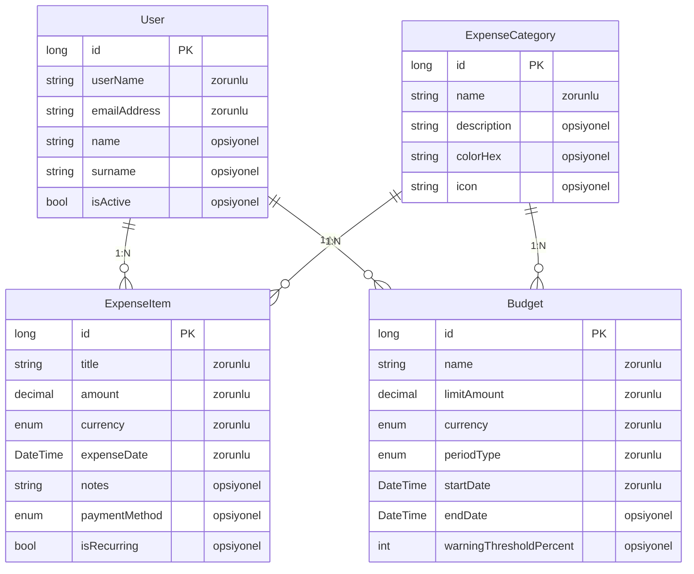

# expensecategoryapp — Talep Analizi

> Bu belge Archipid talep olgunlaştırma (discovery) akışıyla üretildi.

## Orijinal Talep

harcama kalemlerini tuttuğum bir uygulama istiyorum bana aylık haftalık harcamaların grafiklerini önceki aylarla karşılaştırmasını verecek bir yapı

## Özet

Bu uygulama birden fazla kullanıcının kendi harcama kalemlerini kategorilere ve para birimlerine göre ayrı ayrı takip edebildiği, aylık/haftalık harcama trendlerini grafiklerle izleyebildiği ve kategori bazında bütçe limiti tanımlayabildiği kişisel harcama yönetim uygulamasıdır. Her kullanıcı yalnızca kendi kayıtlarını görür.

Kullanıcı önce 'Kira', 'Market', 'Ulaşım' gibi harcama kategorilerini tanımlar ve dilerse her kategori için aylık/haftalık bütçe limiti ile uyarı eşiği belirler. Ardından her harcama kalemini tarih, tutar, para birimi ve kategoriyle kaydeder. Ana ekranda bu kayıtlar otomatik olarak haftalık çizgi grafik, aylık bar grafik ve kategoriye göre pasta grafik olarak görselleştirilir. Bütçe limitleri ve uyarı eşiği kayıt altına alınır; kullanıcı mevcut harcamalarını bütçesiyle karşılaştırarak takip edebilir.

## Kapsam

- (belirtilmedi)

## Kapsam Dışı

- (belirtilmedi)

## Açık Noktalar

- (belirtilmedi)

## Eksiklikler

- (belirtilmedi)

## Öneriler

- (belirtilmedi)

## Veri Modeli

### User — Kullanıcı (Sistem)

| Alan | Tip | Zorunlu | Uzunluk |
|---|---|---|---|
| `id` | long | Evet | — |
| `userName` | string | Evet | 64 |
| `emailAddress` | string | Evet | 256 |
| `name` | string | Hayır | 128 |
| `surname` | string | Hayır | 128 |
| `isActive` | bool | Hayır | — |

**Neye bağlı:** ExpenseItem (1:N, bu tablo "bir" tarafı) · Budget (1:N, bu tablo "bir" tarafı)

### ExpenseCategory — Harcama Kategorisi

| Alan | Tip | Zorunlu | Uzunluk |
|---|---|---|---|
| `id` | long | Evet | — |
| `name` | string | Evet | 100 |
| `description` | string | Hayır | 500 |
| `colorHex` | string | Hayır | 7 |
| `icon` | string | Hayır | 50 |

**Neye bağlı:** ExpenseItem (1:N, bu tablo "bir" tarafı) · Budget (1:N, bu tablo "bir" tarafı)

### ExpenseItem — Harcama Kalemi

| Alan | Tip | Zorunlu | Uzunluk |
|---|---|---|---|
| `id` | long | Evet | — |
| `title` | string | Evet | 200 |
| `amount` | decimal | Evet | — |
| `currency` | enum (TRY,USD,EUR,GBP,CHF,JPY,CAD,AUD,Other) | Evet | — |
| `expenseDate` | DateTime | Evet | — |
| `notes` | string | Hayır | 1000 |
| `paymentMethod` | enum (Cash,CreditCard,DebitCard,BankTransfer,Other) | Hayır | — |
| `isRecurring` | bool | Hayır | — |

**Neye bağlı:** User (1:N, bu tablo "çok" tarafı) · ExpenseCategory (1:N, bu tablo "çok" tarafı)

### Budget — Bütçe Limiti

| Alan | Tip | Zorunlu | Uzunluk |
|---|---|---|---|
| `id` | long | Evet | — |
| `name` | string | Evet | 200 |
| `limitAmount` | decimal | Evet | — |
| `currency` | enum (TRY,USD,EUR,GBP,CHF,JPY,CAD,AUD,Other) | Evet | — |
| `periodType` | enum (Monthly,Weekly,Yearly) | Evet | — |
| `startDate` | DateTime | Evet | — |
| `endDate` | DateTime | Hayır | — |
| `warningThresholdPercent` | int | Hayır | — |

**Neye bağlı:** User (1:N, bu tablo "çok" tarafı) · ExpenseCategory (1:N, bu tablo "çok" tarafı)

## Elle Geliştirme Gerektirenler

Aşağıdaki maddeler senaryonun gereği ama üretilen koda yansımıyor — kod yazılması gerekir.

| Alan | İş | Neden | Geçici çözüm |
|---|---|---|---|
| entity | Toplam harcama tutarı otomatik hesaplanmıyor | Hesaplanan alan (kalemler toplamı gibi aggregate) üretilmiyor; alanlar düz saklanır. | Dashboard'daki breakdown/list widget'ları toplamı görsel olarak sunar; ayrı bir 'toplam' alanı tutulmaz. |
| entity | Önceki aylarla otomatik karşılaştırma grafik ayrımı | Dashboard widget'ları zaman serisi kırılımını (ay bazlı gruplama) destekler ancak 'geçen ay vs bu ay' gibi yan yana ikili karşılaştırma widget tipi mevcut değil. | Aylık Harcama Karşılaştırması widget'ı expenseDate'e göre bar grafik olarak tüm ayları listeler; kullanıcı barları karşılaştırabilir. |
| validation | Bütçe limitine yaklaşınca otomatik uyarı/bildirim gönderilemiyor | SLA/eşik bazlı otomatik bildirim ve eskalasyon mekanizması bu sürümde desteklenmiyor. Bütçe limiti ve uyarı eşiği (warningThresholdPercent) kayıt altına alınır ancak aşım otomatik olarak tespit edilip e-posta/bildirim gönderilemez. | Kullanıcı dashboard'daki kategoriye göre harcama grafiğini ve bütçe listesini manuel olarak inceleyerek kendi limitini takip edebilir. |
| entity | Çoklu döviz harcamalarında ortak para birimine çevirme yapılamıyor | Hesaplanan alan ve döviz kuru entegrasyonu bu sürümde desteklenmiyor. Her harcama kendi para birimiyle saklanır; farklı dövizlerdeki harcamaların toplamı tek bir para biriminde gösterilemiyor. | Kullanıcı harcamaları para birimi bazında ayrı ayrı görüntüleyebilir; tek para biriminde toplam isteniyorsa aynı para birimindeki harcamalar gruplanarak dashboard'dan izlenebilir. |
