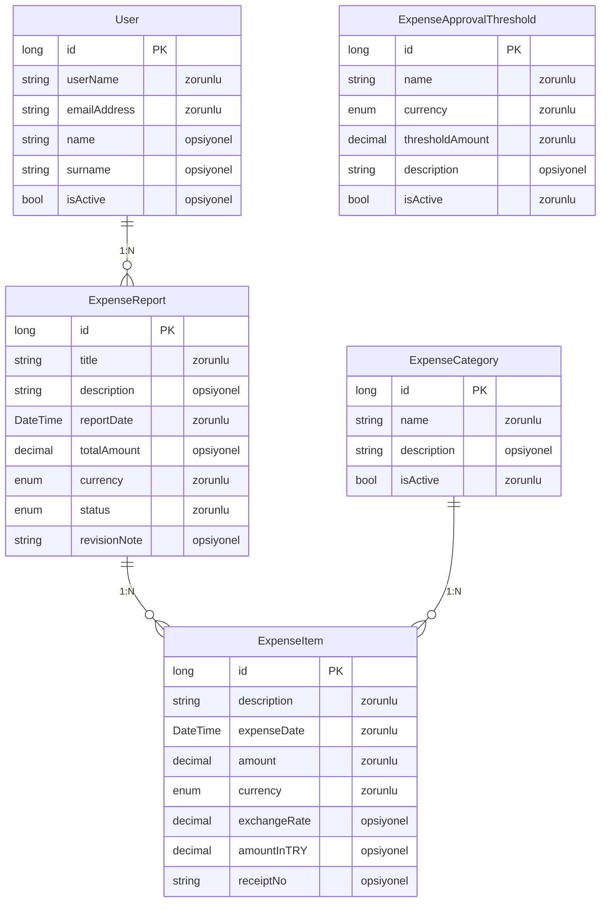
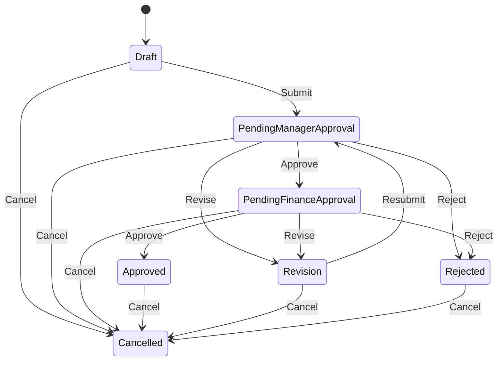
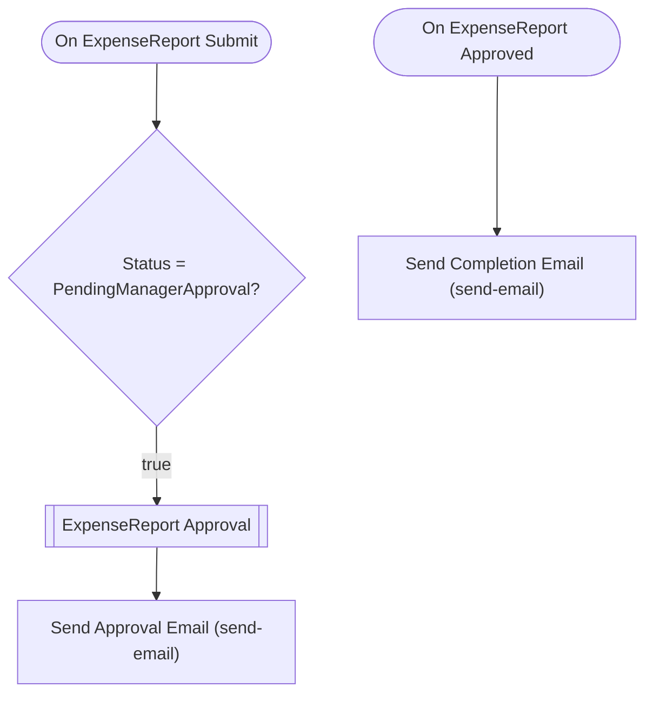

# expensecategoryapp — Talep Analizi

> Bu belge Archipid talep olgunlaştırma (discovery) akışıyla üretildi.

## Orijinal Talep

şirketim için gider takip uygulaması istiyorum. çalışanlar giderlerini girecek giderler kullanıcının bağlı olduğu yönetici ve finans müdürü onayına düşecek. gider kalemleri parametrik olarak değişebilir

## Özet

Bu uygulama, şirket çalışanlarının iş giderlerini (yemek, ulaşım, konaklama vb.) kayıt altına almasını ve şirket onay sürecinden geçirerek resmileştirilmesini sağlar. Yabancı para birimiyle yapılan harcamalarda o günün döviz kuru da kaydedilir. Gider kategorileri ve finans onayı için tutar eşiği yönetim tarafından parametrik olarak tanımlanabilir.

Çalışan bir gider raporu oluşturur ve harcama kalemlerini kategorilere göre girer; dövizli kalemlerde o günkü kuru ve TRY karşılığını da belirtir. Raporu onaya gönderdiğinde önce bağlı olduğu yöneticiye düşer. Yönetici onaylarsa rapor otomatik olarak Finans Müdürü'ne iletilir — ancak bu adım yalnızca belirlenen tutar eşiğinin üzerindeki raporlar için devreye girer. Finans Müdürü nihai onayı verince rapor tamamlanır. Herhangi bir adımda revize istenirse çalışana geri döner, düzeltip yeniden gönderebilir. Onaylanması mümkün görülmeyen raporlar ise doğrudan reddedilebilir ve süreç kapanır.

## Kapsam

- (belirtilmedi)

## Kapsam Dışı

- (belirtilmedi)

## Açık Noktalar

- (belirtilmedi)

## Eksiklikler

- (belirtilmedi)

## Öneriler

- (belirtilmedi)

## Veri Modeli

### User — Kullanıcı (Sistem)

| Alan | Tip | Zorunlu | Uzunluk |
|---|---|---|---|
| `id` | long | Evet | — |
| `userName` | string | Evet | 64 |
| `emailAddress` | string | Evet | 256 |
| `name` | string | Hayır | 128 |
| `surname` | string | Hayır | 128 |
| `isActive` | bool | Hayır | — |

**Neye bağlı:** ExpenseReport (1:N, bu tablo "bir" tarafı)

### ExpenseCategory — Gider Kategorisi

| Alan | Tip | Zorunlu | Uzunluk |
|---|---|---|---|
| `id` | long | Evet | — |
| `name` | string | Evet | 200 |
| `description` | string | Hayır | 500 |
| `isActive` | bool | Evet | — |

**Neye bağlı:** ExpenseItem (1:N, bu tablo "bir" tarafı)

### ExpenseApprovalThreshold — Gider Onay Eşiği

| Alan | Tip | Zorunlu | Uzunluk |
|---|---|---|---|
| `id` | long | Evet | — |
| `name` | string | Evet | 200 |
| `currency` | enum (TRY,USD,EUR,GBP) | Evet | — |
| `thresholdAmount` | decimal | Evet | — |
| `description` | string | Hayır | 500 |
| `isActive` | bool | Evet | — |

**Neye bağlı:** bağımsız tablo

### ExpenseReport — Gider Raporu

| Alan | Tip | Zorunlu | Uzunluk |
|---|---|---|---|
| `id` | long | Evet | — |
| `title` | string | Evet | 200 |
| `description` | string | Hayır | 1000 |
| `reportDate` | DateTime | Evet | — |
| `totalAmount` | decimal | Hayır | — |
| `currency` | enum (TRY,USD,EUR,GBP) | Evet | — |
| `status` | enum (Draft,PendingManagerApproval,PendingFinanceApproval,Approved,Revision,Rejected,Cancelled) | Evet | — |
| `revisionNote` | string | Hayır | 1000 |

**Neye bağlı:** User (1:N, bu tablo "çok" tarafı) · ExpenseItem (1:N, bu tablo "bir" tarafı)

### ExpenseItem — Gider Kalemi

| Alan | Tip | Zorunlu | Uzunluk |
|---|---|---|---|
| `id` | long | Evet | — |
| `description` | string | Evet | 500 |
| `expenseDate` | DateTime | Evet | — |
| `amount` | decimal | Evet | — |
| `currency` | enum (TRY,USD,EUR,GBP) | Evet | — |
| `exchangeRate` | decimal | Hayır | — |
| `amountInTRY` | decimal | Hayır | — |
| `receiptNo` | string | Hayır | 100 |

**Neye bağlı:** ExpenseReport (1:N, bu tablo "çok" tarafı) · ExpenseCategory (1:N, bu tablo "çok" tarafı)

## İş Akışları

### Gider Raporu — durum makinesi

**Onay adımları**

| # | Adım | Atanan | Aksiyonlar | Zorunlu alanlar |
|---|---|---|---|---|
| 1 | Yönetici Onayı | manager: `1` | Onayla (approve), Revize Et (revise) | `revisionNote` |
| 2 | Finans Müdürü Onayı | Rol: `FinanceManager` | Onayla (approve), Revize Et (revise) | `revisionNote` |

Reddedilirse kayıt **`Revision`** durumuna döner.

### Akış: ExpenseReport Approval Flow

Auto-generated approval flow for ExpenseReport. Customize email templates and add conditions as needed.

## Elle Geliştirme Gerektirenler

Aşağıdaki maddeler senaryonun gereği ama üretilen koda yansımıyor — kod yazılması gerekir.

| Alan | İş | Neden | Geçici çözüm |
|---|---|---|---|
| entity | Toplam tutar gider kalemlerinden otomatik hesaplanmıyor | Hesaplanan alan üretimi desteklenmiyor; kalem toplamı ExpenseReport.totalAmount alanına otomatik yazılamaz | Kullanıcı totalAmount alanını manuel girer veya bu hesaplama backend geliştirmesiyle eklenir |
| entity | TRY karşılığı (amountInTRY) döviz kurundan otomatik hesaplanmıyor | Hesaplanan alan üretimi desteklenmiyor; amount × exchangeRate çarpımı amountInTRY alanına otomatik yazılamaz | Kullanıcı amountInTRY alanını manuel girer veya hesaplama backend geliştirmesiyle eklenir |
| approval | Finans Müdürü onay eşiğinin approval condition'ına dinamik bağlanması | Approval adımındaki condition sabit değer karşılaştırması yapar; ExpenseApprovalThreshold tablosundaki parametrik değeri dinamik olarak okuyamaz | Eşik değeri sisteme tanımlandıktan sonra approval step condition'ı sabit olarak güncellenmeli. Eşik sık değişmiyorsa bu yönetilebilir; sık değişiyorsa backend geliştirmesi gerekir |
| approval | Çalışanın kendi gider raporunu onaylayamaması garantisi | Yönetici, org şeması üzerinden çözülüyor (assigneeType: manager). Sistem org şeması yapılandırılmadığında bu kontrolü yapamaz | Organizasyon şeması sisteme tanımlanmalı; aksi hâlde onay Admin rolüne düşer |
